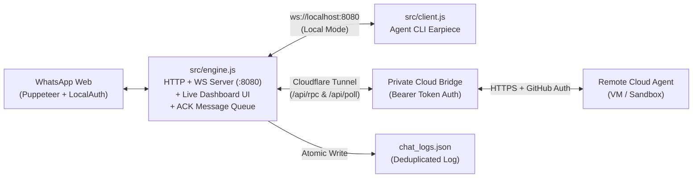

# WhatsApp Engine & Agent Earpiece (`whatsapp-listener`)

[](https://opensource.org/licenses/MIT)
[](https://nodejs.org/)
[](#websocket-protocol)
[](./skills/whatsapp-listener/SKILL.md)

A persistent local **WhatsApp WebSocket Engine**, **CLI Earpiece Listener**, and **Live Web Monitor Dashboard** built on `whatsapp-web.js` for autonomous AI agent workflows (Google Antigravity, Claude Code, Codex, and custom agent runtimes).

---

## System Architecture



### Repository Structure

```text
whatsapp-engine/
├── src/
│   ├── engine.js                              # Persistent WhatsApp client + HTTP/WS server & Live Dashboard (:8080)
│   ├── client.js                              # Dual-transport CLI Earpiece (Local WS + Remote HTTPS Cloud Bridge)
│   ├── dashboard.js                           # Standalone web monitor UI
│   └── utils/
│       ├── auth.js                            # Private GitHub-backed Bearer token & tunnel discovery
│       └── logger.js                          # Atomic, deduplicated JSON chat logger
├── scripts/
│   ├── start_cloud_bridge.js                  # Cloudflare HTTPS tunnel daemon + private GitHub config publisher
│   ├── fetch_assignments.js                   # Batch assignment & academic group scanner
│   └── get_media.js                           # Full-res HKDF media attachment downloader by Message ID
├── skills/
│   └── whatsapp-listener/
│       ├── SKILL.md                           # Official Agent Skill instructions
│       └── references/
│           └── websocket-protocol.md          # Full WebSocket & HTTPS Bridge JSON schema reference
├── SKILL.md                                   # Root skill entrypoint for single-repo skill installers
├── engine.js                                  # Root shim -> src/engine.js
├── client.js                                  # Root shim -> src/client.js
└── dashboard.js                               # Root shim -> src/dashboard.js
```

---

## Core Capabilities

1. **ACK-Verified Message Queue (Zero Dropped Messages)**
   - Incoming messages that arrive while the AI agent is busy processing a turn are buffered in `engine.js` (up to 100 messages).
   - Messages are **only** removed from the queue when an active `listener` client sends an `ack_message` frame.
   - Passive monitors and filtered listeners (`--keyword`, `--chat`, `--mentioned`) never drain unmatched messages from the queue.
2. **Private HTTPS Cloud Bridge & Agent Intercom**
   - `scripts/start_cloud_bridge.js` exposes `localhost:8080` over a Cloudflare HTTPS tunnel protected by a 256-bit Bearer token stored exclusively in your private `<owner>/whatsapp-bridge-config` GitHub repository.
   - Remote Cloud VMs automatically authenticate via `gh auth token` / `git credential fill` and communicate with the local host agent using `node client.js agent-send "local|cloud" "<Message>"`.
3. **Native HKDF-SHA256 + AES-256-CBC Media Decryption**
   - `fetch_media` (`scripts/get_media.js`) downloads encrypted `.enc` blobs directly from WhatsApp's MMS CDN and performs native RFC 5869 HKDF key expansion and AES-256-CBC decryption to recover full-resolution images and documents even when WhatsApp Web's internal `downloadMedia()` fails.
4. **Group Creation & `@mention` Tagging**
   - Create groups directly from the CLI (`create-group`) by preloading `WAWebNewGroupFlowLoadable` in headless mode, send clickable `@mentions` (`--mentions`), and filter incoming group listeners to wake up only when your number is tagged (`--mentioned`).
5. **Read-Only Safety Lock & Live Monitor (`http://localhost:8080/`)**
   - Listening never triggers automatic blue ticks (`sendSeen`) or auto-replies. Built-in dark-mode dashboard on `http://localhost:8080/` streams WhatsApp messages and Cloud ↔ Local Agent Intercom events in real time.

---

## Installation & Setup

### 1. Clone & Install Dependencies

```bash
git clone https://github.com/chetangoswami/whatsapp-engine.git
cd whatsapp-engine
npm install
```

### 2. Start the Engine & Link WhatsApp

```bash
npm start
# or: node engine.js
```

- On first run, the engine generates a QR code in your terminal **and** creates a self-refreshing `WhatsApp_QR.html` file in the project root (plus `media/whatsapp_qr.png`).
- Scan the QR code using **WhatsApp -> Linked Devices -> Link a Device**.
- Once linked, you will see:
  ```text
  [Engine] WhatsApp Client is READY and listening for messages!
  ```

### 3. Install the Agent Skill

Copy `skills/whatsapp-listener` into your global or workspace skills folder:

```powershell
# Global Antigravity skills directory:
Copy-Item -Path ".\skills\whatsapp-listener" -Destination "$HOME\.gemini\config\skills\whatsapp-listener" -Recurse -Force

# Or workspace-level skills directory:
Copy-Item -Path ".\skills\whatsapp-listener" -Destination ".\.agents\skills\whatsapp-listener" -Recurse -Force
```

---

## CLI Reference (`client.js`)

| Command | Description | Example |
| :--- | :--- | :--- |
| `status` | Checks if the engine is online, authenticated, and reports queue size. | `node client.js status` |
| `listen` | Connects to the engine and waits for the next matching message, prints `[WHATSAPP MESSAGE RECEIVED]`, acknowledges receipt, and exits with `0`. | `node client.js listen` |
| `listen --keyword` | Wakes up only when a message contains the specified keyword (case-insensitive). | `node client.js listen --keyword "jarvis"` |
| `listen --chat` | Wakes up only for messages from a matching sender, group name, or ChatID. | `node client.js listen --chat "Gamla"` |
| `listen --mentioned` | Wakes up only when your WhatsApp account is explicitly `@mentioned` in a group. | `node client.js listen --mentioned` |
| `listen --continuous` | Keeps streaming matching messages without exiting after the first message. | `node client.js listen --continuous` |
| `send` | Sends a text message, quoted reply (`--replyTo`), attachment (`--media`), or `@mentions` (`--mentions`). | `node client.js send "120363...@g.us" "Hi @919876543210" --mentions "9876543210"` |
| `create-group` | Creates a new WhatsApp group with one or more phone numbers or JIDs. | `node client.js create-group "Project Sync" "9876543210,9123456789"` |
| `agent-send` | Sends a direct intercom message between Local Agent and Cloud Agent (`local` or `cloud`). | `node client.js agent-send "cloud" "Ready to sync"` |
| `history` | Fetches recent messages (with IST timestamps) from matching chats. | `node client.js history "Gamla" 50` |
| `groups` | Lists all WhatsApp groups (optionally filtered by name substring). | `node client.js groups "CSE"` |
| `ui_search` | Fallback Puppeteer DOM search for unindexed community/subgroup chats. | `node client.js ui_search "Gamla" "Gamla Discussions"` |

### Utility Scripts (`scripts/`)

```bash
# Download a specific message's media attachment into ./media/
node scripts/get_media.js "<MessageID>" [outputFilenameWithoutExt]

# Scan academic/college groups for assignment & deadline notices
npm run assignments
```

---

## WebSocket Protocol (`ws://localhost:8080`)

See the full protocol documentation in [`skills/whatsapp-listener/references/websocket-protocol.md`](./skills/whatsapp-listener/references/websocket-protocol.md) for JSON request/response schemas (`register_listener`, `register_monitor`, `ack_message`, `status`, `send_message`, `fetch_history`, `list_chats`, `ui_search_chat`, `fetch_media`).

---

## License

MIT © [Chetan Goswami](https://github.com/chetangoswami)
